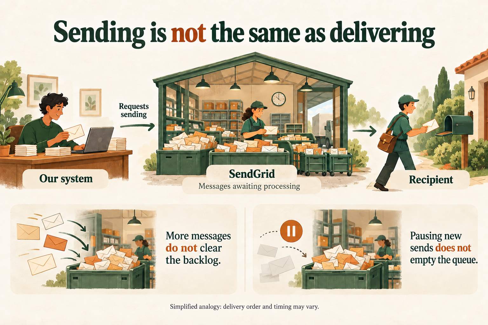

An important part of my work happens in conversations between the people who need a solution and those who will build it. Clients, product owners and developers may be discussing the same system while bringing different knowledge and concerns.

I help connect these perspectives: understanding the business need, organising information and explaining the technical aspects in a way that makes sense to the listener. I use everyday examples, metaphors and documentation adapted to the audience.

## The same solution needs to answer different questions

When proposing an email delivery system using a CMS, a content management tool, I needed to present the solution to two audiences: the team who would develop it and the employees who would use it.

For the technical team, I needed to explain how the proposal would fit into the existing system. I described the microservices architecture — services with defined responsibilities working together — and the role of each service. I also documented the integration points: where the new solution’s responsibilities would begin and end, and how it would connect to the current system. The proposal included the types of cloud services planned for the solution.

The architecture diagram helped readers follow these relationships. Alongside identifying the technologies, I needed to show what each part would do and how the parts would work together, providing a basis for discussing implementation.

For employees, the explanation needed to answer a different question: how would they use this solution at work? I prepared a presentation focused on usage and represented the process in BPMN, a visual way to show activities and the flow between them. The aim was to let them follow the process without needing to understand the system’s internal structure.

| Audience | Main question | Material prepared |
| --- | --- | --- |
| Technical team | How do we build and integrate the solution? | Technical documentation and an architecture diagram |
| Employees | How do we use the solution at work? | Usage explanation and an activity flow |

Both explanations described the same proposal, but started with different questions. This is a choice I make when documenting: selecting the content and level of detail according to what each person needs to understand.

## Using something familiar to explain something new

In another situation, I needed to explain a backlog of emails waiting to be sent. Our system used SendGrid, an email delivery service, through the SMTP protocol. It was important to clarify the difference between handing a message to the service and that message actually moving on to its destination.

I used the postal service as a metaphor: our system prepared a letter and handed it to the post office; SendGrid was responsible for forwarding it. Handing the letter over, however, did not mean it had already reached its recipient.

To illustrate the backlog, I compared processing to a queue. In the analogy, adding another ten or a hundred letters did not clear those already waiting. This was a simplification to explain the delay, rather than an exact description of the service’s delivery order.

The comparison helped explain why stopping new submissions would not immediately restore normal operation: it could limit the queue’s growth, but pending messages would still need processing. The explanation distinguished what our system had already requested from what the service still needed to complete.

That is how I use analogies: to establish a familiar starting point and then explain the technical details needed for the situation.

## Communication works in both directions

Adapting language also matters within technical teams. A junior developer and an architect may draw on different experience. Development, quality assurance and infrastructure teams also view a problem through different responsibilities.

I often act as a connection between these people. I help those closer to the business organise their needs more systematically and encourage technical professionals to explain their reasoning without relying only on their field’s terminology.

What I observe in these conversations is a better sense of how to communicate: what needs explaining and which language makes understanding easier.

For me, clarity is part of technical work. I aim to contribute to building the solution while helping the people involved understand what we are building, why it is needed and how it will be used.
