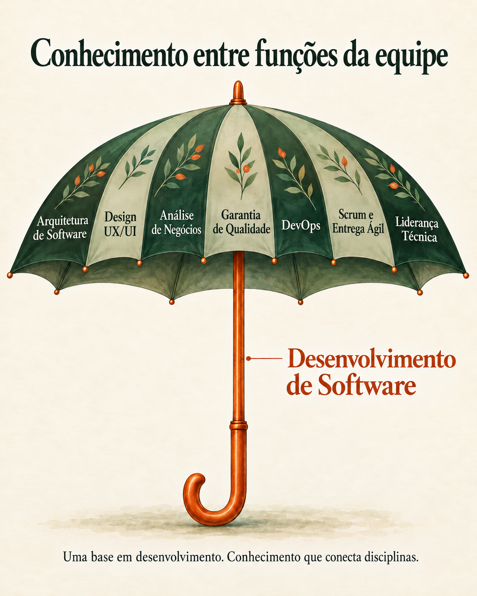

## Um profissional, responsabilidades conectadas

A engenharia de software é minha área principal. Dependendo do projeto, minha contribuição também inclui compreender necessidades de negócio, estruturar soluções, coordenar testes e ajudar a equipe a organizar o trabalho.

O guarda-chuva representa como essas áreas se conectam. O desenvolvimento de software forma a haste e o cabo: minha base prática. A cobertura representa conhecimentos de disciplinas próximas, que me ajudam a compreender o que outros especialistas precisam e como o trabalho deles se relaciona com o meu. São áreas de conhecimento e contribuição, e não uma lista de cargos que ocupei.

### O cabo: desenvolvimento de software

Atuo na interface do usuário, na lógica da aplicação e no acesso a dados. Acompanhar um requisito por essas camadas me ajuda a compreender dependências, investigar problemas e decidir onde uma alteração deve ser feita.

| Foco | Como contribuo na prática |
| --- | --- |
| Desenvolvimento full-stack | Desenvolvo interfaces, lógica da aplicação, APIs e acesso a dados com Angular, TypeScript, C#, .NET e SQL Server. Meu trabalho inclui agendamento de aulas, acompanhamento de progresso, relatórios e prática de pronúncia com os serviços de fala do Azure. |
| Engenharia de desempenho | Otimizo consultas e procedimentos armazenados, refatoro o acesso a dados e investigo comportamentos sensíveis ao desempenho, incluindo trabalho em uma plataforma de aprendizagem multilíngue. |

### A cobertura: conhecimento sobre diferentes funções da equipe

Minha experiência nessas disciplinas varia. Algumas envolvem implementação ou coordenação direta; outras orientam minha forma de desenvolver e colaborar com especialistas.

| Disciplina | Como esse conhecimento aparece no meu trabalho |
| --- | --- |
| Arquitetura de Software | Defino responsabilidades dos serviços, limites de integração e bases reutilizáveis. Na Telegestão, isso incluiu arquitetura de microserviços, modelos, bibliotecas e padrões de desenvolvimento. Também crio bibliotecas reutilizáveis em C# e Flutter. |
| Design UX/UI | Aplico conhecimentos de experiência do usuário e acessibilidade no desenvolvimento de interfaces, incluindo melhorias de acessibilidade na plataforma de aprendizagem. |
| Análise de Negócios | Esclareço necessidades com clientes e responsáveis pelo produto e preparo propostas com escopo, premissas, casos de uso e fluxos para validação antes do desenvolvimento. |
| Garantia de Qualidade | Coordeno testes e contribuo com verificações automatizadas em Playwright, execuções noturnas, testes básicos e de regressão, relatórios de evidências e modelos de testes. |
| DevOps | Configuro pipelines de entrega quando o projeto precisa, incluindo pipelines do Azure DevOps na GFT. |
| Scrum e Entrega Ágil | Utilizo conhecimentos de formas ágeis de trabalho nas estimativas, na organização e na priorização de tarefas de desenvolvimento e testes. |
| Liderança Técnica | Apoio a integração de desenvolvedores nas tecnologias e nas regras de negócio e documento arquitetura, decisões, processos e orientações para testes. |

### Dentro da equipe

Conecto a implementação aos requisitos, aos testes e à documentação. Contribuo diretamente com o código enquanto ajudo desenvolvedores e profissionais de testes a compreender o propósito do trabalho e as dependências entre suas tarefas.

Por exemplo, um requisito descreve o comportamento que precisamos construir; a implementação determina quais partes do sistema mudam; os testes verificam o comportamento resultante. Atuar nessas atividades me ajuda a manter a necessidade original em vista durante o trabalho.

### Na empresa

Ajudo a transformar necessidades de negócio em propostas que possam ser discutidas e validadas. Adapto explicações técnicas a diferentes públicos e documento decisões e processos para que o contexto continue disponível além das pessoas que os criaram.

Isso também apoia a continuidade quando alguém entra em um projeto ou precisa compreender uma decisão anterior. Documentação e integração de novos profissionais fazem parte de dar continuidade ao trabalho.

### O que mantém o guarda-chuva unido

O valor está nas conexões: os requisitos orientam o código, a implementação informa os testes e a documentação preserva o contexto para trabalhos futuros. Minha base em desenvolvimento me ajuda a relacionar essas discussões à construção prática do software.

As responsabilidades que assumo variam conforme o projeto. Procuro contribuir onde minha experiência é útil e trabalhar com pessoas cujos conhecimentos complementam os meus.
